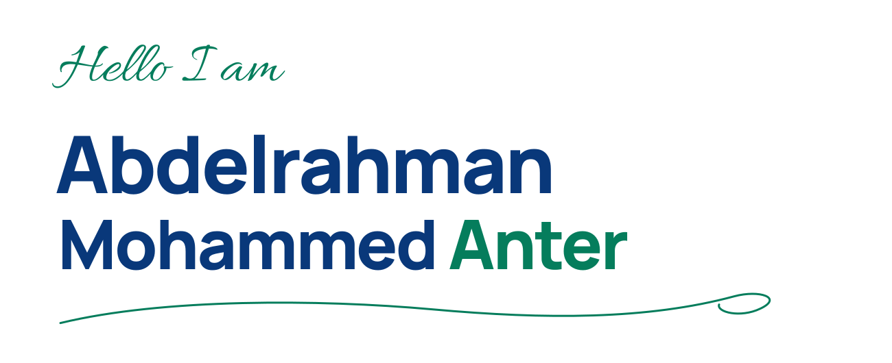

<!-- Place the attached image at ./assets/banner.jpeg in your profile repository -->

**Full Stack Engineer | React · Node.js · MongoDB · AWS**

## About Me

- Full Stack Engineer building **scalable web applications** with React, TypeScript, Node.js, and MongoDB.
- Hands-on with **RESTful APIs**, **JWT authentication (HttpOnly cookies)**, **performance optimization**, and **cloud deployment on AWS**.
- Graduate of the **Digilians AI-Based Software Development** diploma (Digital Egypt Pioneers Initiative) and **Mechatronics Engineering** graduate.
- Currently an intern at the **Ministry of Justice, Egypt**, developing the ROC project across frontend and backend.
  

## Tech Stack

### Languages

### Frontend

### Backend

### Databases

### Cloud & DevOps

### Security & Authentication

### Tools

## Experience

### Intern: Ministry of Justice, Egypt
*September 15, 2026 – Present (ongoing)*

- Developing the **ROC project** as a Full Stack Engineer, contributing to both frontend and backend development.
- Supporting end-to-end application development, ensuring seamless communication between frontend interfaces, backend services, and AI-powered functionalities.

### Full Stack Development: Personal & Academic Projects

- Designed, developed, and maintained full stack web applications using **React** and **Node.js**.
- Built **RESTful APIs** and **MongoDB schemas** (including compound indexes) integrated with front-end components.
- Implemented **JWT authentication via HttpOnly cookies**; improved performance through code-splitting, caching, and memoization.
- Deployed applications on **AWS**, applying CI/CD concepts and MVC best practices.

## Featured Projects

### MianHRM: Human Resource Management System
*MERN Stack*

- Automates the full employee lifecycle, including payroll, attendance, and leave management.
- Backend payroll engine that calculates net salaries with bonuses and automatic absence/late deductions.
- Real-time notifications and live HR dashboard updates with Socket.io.

<!-- Repository: YOUR_MIANHRM_REPOSITORY_URL -->

### E-Commerce Platform
*MERN Stack*

- JWT authentication and role-based access control (RBAC).
- Product and order management.
- Deployed on AWS.

<!-- Repository: YOUR_ECOMMERCE_REPOSITORY_URL -->

### addadak: Smart Utility Management Ecosystem
*Team Graduation Project (5 members), Digilians AI-Based Software Development diploma, Digital Egypt Pioneers Initiative, in association with NTI*

- Microservices platform (Auth, Metrics, AI Forecast, Payment, Alerts) for monitoring electricity, gas, and water consumption.
- Predicts future usage and bills, and lets users pay utilities online.
- Contributed to the backend microservices and the React front end.

<!-- Repository: YOUR_ADDADAK_REPOSITORY_URL -->

## Education

**Bachelor's Degree in Mechatronics Engineering**
Faculty of Engineering, AIET | Graduated 2022

## Certifications

Issued July 2026 · Expires July 2029 · Validation Number: `30e401ab2f8842b182259ad06cf0eab9`

## Connect with Me

<!-- Optional: add a CV badge once your CV has a public link

-->

